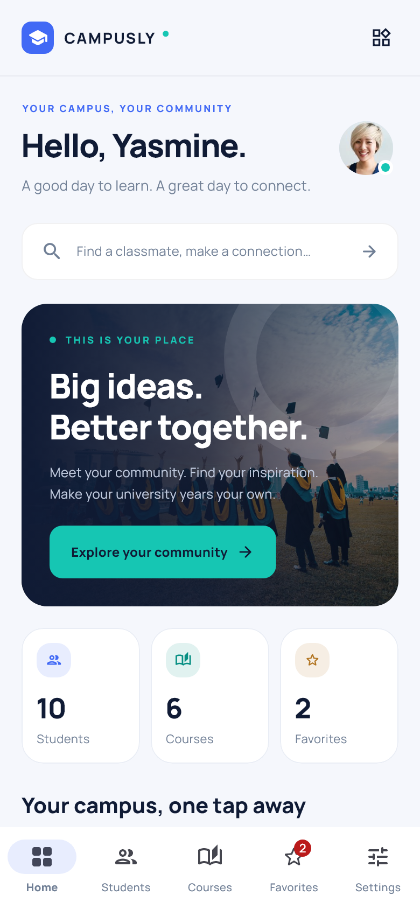

# CAMPUSLY — Application Flutter de vie universitaire

**Your Campus, Your Community.**

## Présentation du projet

Application Flutter de vie universitaire réalisée pour le module Développement mobile de l’Université Mundiapolis, classe **2ACINFO**. CAMPUSLY réunit un annuaire étudiant, un catalogue de cours, des favoris et des préférences dans une interface Material 3.

L’application permet de rechercher des étudiants, de consulter leurs profils, de découvrir les cours et de personnaliser son expérience. Elle met en pratique les widgets Flutter **Icon**, **CircleAvatar**, **Card** et **ListTile**, avec des données de démonstration et une sauvegarde locale des préférences.

## Réalisation en binôme

Ce projet a été réalisé en binôme par :

- **Abdelmounim Maani**
- **Ibrahim Ellhiady**

Université Mundiapolis · **2ACINFO** · Développement mobile — TP Flutter Widgets

## Objectifs pédagogiques

- Maîtriser **Icon**, **CircleAvatar**, **Card** et **ListTile** dans des situations concrètes.
- Organiser une application en modèles, données, écrans et composants réutilisables.
- Gérer les interactions avec `setState`, `Navigator.push` et un contrôleur partagé simple.
- Créer une expérience cohérente sur téléphone Android, tablette et navigateur.
- Vérifier les comportements avec des tests, sans dépendre d’un serveur.

## Technologies et prérequis

- **Flutter 3.50 ou version compatible ultérieure**, Dart 3.14 ou ultérieur.
- Material Design 3 : paquets officiels `material_ui` et `cupertino_ui`.
- `cupertino_icons` pour la police d’icônes Cupertino.
- `shared_preferences` pour les favoris, inscriptions et réglages locaux.
- `flutter_test`, `flutter_lints` pour la vérification.
- Police Manrope intégrée au projet, avec sa licence OFL.
- VS Code avec extensions Flutter et Dart ; Android SDK et JDK compatibles pour Android ; Chrome pour le Web.

Le SDK détecté sur la machine est Flutter 3.50. Depuis cette version, les imports Material et Cupertino intégrés au SDK sont dépréciés. Le projet suit les imports des nouveaux paquets officiels : [guide Flutter](https://docs.flutter.dev/release/breaking-changes/material-ui-and-cupertino-ui). Aucun framework externe de gestion d’état n’est utilisé.

## Installation et lancement

Depuis la racine du projet :

```sh
flutter doctor
flutter pub get
flutter devices
flutter run
```

Choisir un émulateur Android ou un téléphone connecté. Dans VS Code, ouvrir `lib/main.dart`, choisir l’appareil puis appuyer sur **F5**. Les configurations de lancement sont dans `.vscode/launch.json`.

Pour le Web :

```sh
flutter run -d chrome
```

Pour préparer une version distribuable :

```sh
flutter build web
flutter build apk --debug
```

La version Android de démonstration utilise la signature de débogage. Une signature privée devra être configurée avant une publication en boutique.

Les images et la police sont locales ; seul l’exemple d’avatar réseau du laboratoire nécessite une connexion. `flutter pub get` demande une connexion lors de la première installation. Les données sont conservées sur l’appareil ou dans le stockage du navigateur et ne sont pas synchronisées entre appareils.

### Cas du workspace Windows restreint

L’environnement de réalisation interdit à Dart l’ouverture des pipes de sous-processus nécessaires au lanceur Flutter. Un cache de SDK isolé a été créé dans `.tooling/`, sans modifier le SDK installé. Le script facultatif `tool/flutter.ps1` sélectionne ce cache lorsqu’il existe, sinon utilise Flutter normalement. Ce script ne lève pas les restrictions Windows.

Les résultats réellement obtenus et les méthodes alternatives employées sont décrits dans [docs/VERIFICATION.md](docs/VERIFICATION.md). Sur une installation locale normale, utiliser les commandes Flutter standard ci-dessus.

## Fonctionnalités

- **Accueil** : profil fictif de Yasmine, raccourci de recherche, trois compteurs, accès rapide, cours mis en avant, nouveaux étudiants et résumé optionnel du campus.
- **Étudiants** : dix identités fictives, recherche immédiate par prénom ou nom sans distinction de casse, filtres par filière, tri et groupes alphabétiques, profils détaillés et copie de l’e-mail.
- **Suppression** : glisser une carte vers la gauche ; le message permet d’annuler immédiatement. Le compteur et les favoris suivent la suppression.
- **Favoris** : étoile interactive dans l’annuaire et les profils ; écran dédié avec état vide et compteur synchronisé dans l’AppBar.
- **Cours** : six cartes illustrées avec modules, enseignant, durée et niveau ; recherche par titre, sujet ou enseignant ; filtres par catégorie et inscriptions ; tri recommandé, alphabétique ou par durée. Chaque cours possède une fiche avec programme et une inscription locale annulable. Toucher une carte affiche un SnackBar ; les boutons ont leurs propres actions.
- **Réglages** : compte, rappels dans l’application, langue anglais/français, confidentialité, aide, mode sombre réel, résumé optionnel et déconnexion avec confirmation.
- **Widgets Lab** : menu explicite accessible dans l’AppBar, sur l’accueil et dans l’aide. Les cinq pages demandées sont séparées et identifiables.
- **Adaptation** : barre de navigation inférieure sur mobile et tablette ; navigation latérale à partir de 1100 pixels. Les listes de cours adaptent leur nombre de colonnes.

Le compte et les inscriptions sont des démonstrations locales. La déconnexion mène à un écran permettant de reprendre la session fictive. Les rappels restent dans l’application ; aucun service de notifications push n’est utilisé. La langue modifie les principaux libellés de l’application ; les titres des cours et les explications pédagogiques du laboratoire gardent leur contenu d’origine.

## Architecture

```text
lib/
  main.dart                         démarrage, thèmes, navigation, entrée de session
  controllers/app_controller.dart   état partagé et persistance
  models/
    etudiant.dart                   modèle immutable avec favori
    cours.dart                      informations et programme d’un cours
  data/
    students_data.dart              dix étudiants fictifs
    courses_data.dart               six cours fictifs
  theme/app_theme.dart              palette, typographie, thèmes clair et sombre
  pages/
    home_page.dart
    students_page.dart
    student_details_page.dart
    courses_page.dart
    course_details_page.dart
    favorites_page.dart
    settings_page.dart
    widgets_lab_page.dart
    icon_page.dart
    avatar_page.dart
    card_page.dart
    listtile_page.dart
    contacts_page.dart
  widgets/
    student_card.dart
    custom_avatar.dart
    course_card.dart
    bottom_navigation.dart
    empty_state.dart
    page_intro.dart
test/
  controller_test.dart
  widget_test.dart
docs/
  PRESENTATION_ORALE.md
  REQUIREMENTS.md
  VERIFICATION.md
assets/
  fonts/                            Manrope et licence
  images/                           images des cours et du campus
  portraits/                        exemples de visages
```

`AppController` étend ChangeNotifier. Les widgets concernés écoutent ses changements avec ListenableBuilder. Les modèles restent immutables ; `copyWith` crée un étudiant avec son nouvel état de favori. Les filtres et la ligne de réglage sélectionnée utilisent `StatefulWidget` et `setState`. Les écritures locales sont sérialisées pour éviter qu’une ancienne modification remplace une plus récente. Une erreur de stockage affiche un bandeau sans perdre les changements actifs en mémoire.

Les deux pages `ListTilePage` et `ContactsPage` réutilisent les vrais écrans de réglages et d’annuaire, dans des routes de démonstration distinctes. Cela rend les exigences visibles sans dupliquer la logique.

## Les quatre widgets du TP

| Widget | Usage dans CAMPUSLY | Démonstration dédiée |
| --- | --- | --- |
| Icon | Navigation, services, informations et actions | IconPage : tailles 24/40/64, huit services, semanticLabel, Cupertino et IconButton |
| CircleAvatar | Portraits, initiales et badge de présence | AvatarPage : initiales/réseau/icône/asset, cinq couleurs, bordure 44/40 |
| Card | Étudiants, cours, statistiques et réglages | CardPage : élévation 4, filled, outlined et carte de cours interactive |
| ListTile | Annuaire, coordonnées et lignes de réglages | ListTilePage : Divider, selected, isThreeLine, SwitchListTile et CheckboxListTile |

La fonction `String initiales(String nomComplet)` prend la première lettre des **deux premiers mots** : `Sara El Amrani` donne `SE`. Elle gère les espaces supplémentaires, un nom seul et une chaîne vide.

## Réponses aux questions de réflexion

### Quelle est la différence entre Icon et IconButton ?

Icon affiche un pictogramme. IconButton est un bouton interactif contenant une icône : il propose `onPressed`, un tooltip, une zone de toucher et les comportements d’accessibilité d’un bouton. Dans IconPage, la cloche Cupertino est un IconButton qui affiche exactement « Icône cliquée ».

### Que se passe-t-il si l’URL d’un CircleAvatar est invalide ?

Le chargement de l’image échoue. Sans gestion d’erreur, Flutter signale une erreur et l’image attendue n’apparaît pas. Dans CAMPUSLY, CircleAvatar contient une image découpée avec ClipOval et `Image.network(errorBuilder: ...)`. Le callback retourne les initiales ; `loadingBuilder` les affiche également pendant le chargement. Une erreur d’asset possède le même repli.

### Pourquoi utiliser clipBehavior dans Card ?

La forme arrondie de la carte ne découpe pas automatiquement tous ses enfants. `Clip.antiAlias` empêche l’image et l’effet de toucher de dépasser les coins. Il lisse le contour, avec un léger coût de découpage justifié ici par les images.

### Pourquoi placer InkWell à l’intérieur de Card ?

Card apporte une surface Material sur laquelle InkWell peut peindre son effet d’onde. Le découpage de la carte limite cet effet à sa forme. `onTap` peut alors afficher un retour ou ouvrir un écran. Les boutons Détails et S’inscrire gardent leurs actions propres.

### Quels sont les avantages de ListTile par rapport à Row ?

ListTile propose une structure prête à l’emploi : leading, title, subtitle, trailing, alignements, espacements, sélection et toucher. Il réduit le code pour une ligne standard et donne une présentation cohérente. Row reste préférable pour une mise en page plus personnalisée qui ne correspond pas à une tuile.

### Comment fonctionne le système de favoris ?

Chaque étudiant possède un identifiant stable et un booléen `favori`. Toucher l’étoile appelle `AppController.toggleFavorite(id)`. Le contrôleur remplace l’objet avec `copyWith`, puis appelle `notifyListeners`. L’annuaire, le profil, la page Favoris et les compteurs relisent alors le même état. La page Favoris filtre simplement les étudiants dont `favori` vaut true. Les identifiants favoris sont sauvegardés avec SharedPreferences ; le redémarrage reconstitue leur état. Supprimer un étudiant le retire aussi des favoris ; Annuler restaure l’objet et sa valeur précédente.

## Vérification

Commandes standard à exécuter sur une installation Flutter normale :

```sh
flutter pub get
flutter analyze
flutter test
```

Les tests vérifient les comportements de l’utilisateur : navigation, recherche, favoris, suppression/annulation, cours, thème, langue, déconnexion, accès au laboratoire et repli des images. Ils couvrent aussi plusieurs largeurs d’écran. Consulter [le rapport réel](docs/VERIFICATION.md) pour distinguer les commandes bloquées des contrôles exécutés avec succès.

Résultat obtenu avec les composants officiels exécutés directement dans ce workspace : **16 tests réussis, 0 diagnostic d’analyse, compilation Web réussie**. Les commandes du lanceur Flutter restent bloquées par les permissions des sous-processus Windows ; aucun APK n’est présenté comme construit ou testé.

## Captures d’écran

Dix captures réelles du rendu Flutter sont disponibles dans `docs/screenshots/`. Elles utilisent deux favoris préparés pour la démonstration :

| Capture | Contenu attendu |
| --- | --- |
| [Accueil mobile](docs/screenshots/home-mobile.png) | Message de bienvenue, campus et statistiques |
| [Annuaire](docs/screenshots/students-mobile.png) | Recherche, filtres, avatar et étoile |
| [Profil](docs/screenshots/profile-mobile.png) | Grand avatar et coordonnées |
| [Cours](docs/screenshots/courses-mobile.png) | Image, catégorie et boutons |
| [Catalogue grand écran](docs/screenshots/courses-desktop.png) | Grille de cartes, recherche et tri |
| [Catalogue sombre](docs/screenshots/courses-dark-desktop.png) | Présentation des cours en mode sombre |
| [Favoris](docs/screenshots/favorites-mobile.png) | Profils conservés |
| [Réglages sombres](docs/screenshots/settings-dark-mobile.png) | Thème sombre et options interactives |
| [Widgets Lab](docs/screenshots/widgets-lab-mobile.png) | Les cinq pages de démonstration |
| [Accueil grand écran](docs/screenshots/home-desktop.png) | Navigation latérale et plusieurs colonnes |

 

## Présentation et grille de conformité

- [Plan oral en français : dix diapositives et démonstrations](docs/PRESENTATION_ORALE.md).
- [Matrice de chaque exigence vers son fichier](docs/REQUIREMENTS.md).
- [Sources des images et de la police](assets/ATTRIBUTION.md).

Les e-mails utilisent `example.com` et les numéros sont volontairement non composables. Les portraits servent uniquement d’illustrations à des identités inventées.
